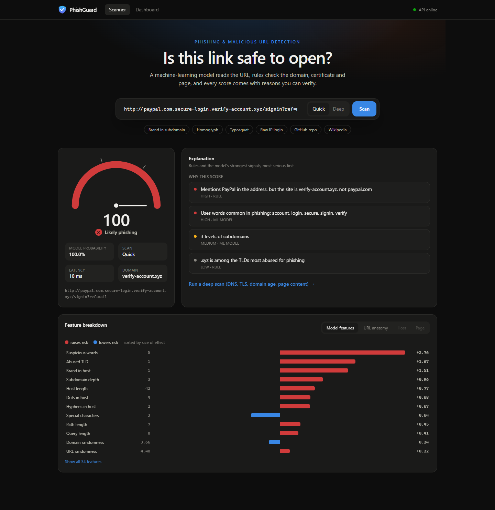
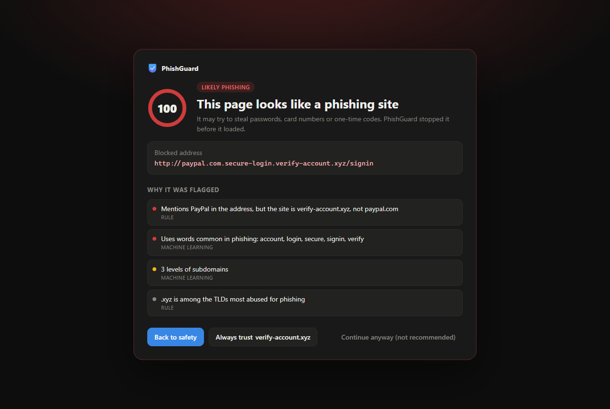
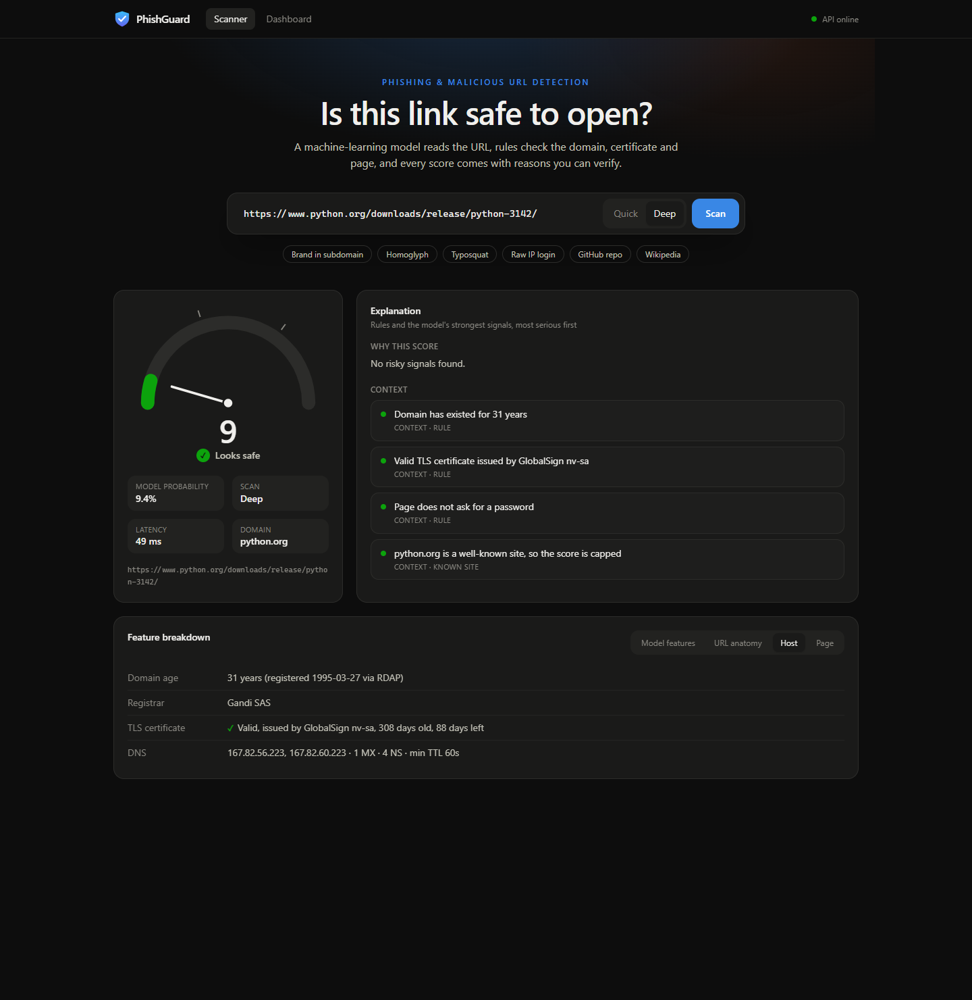
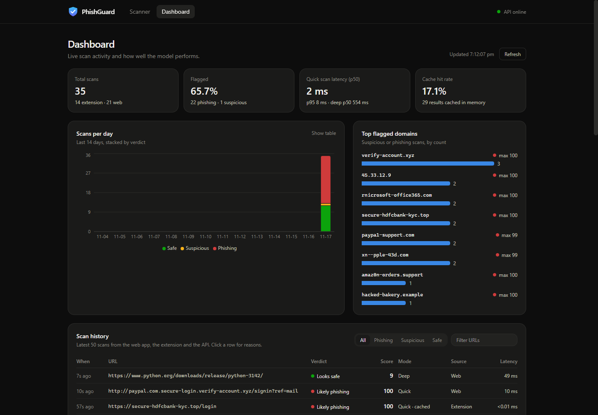
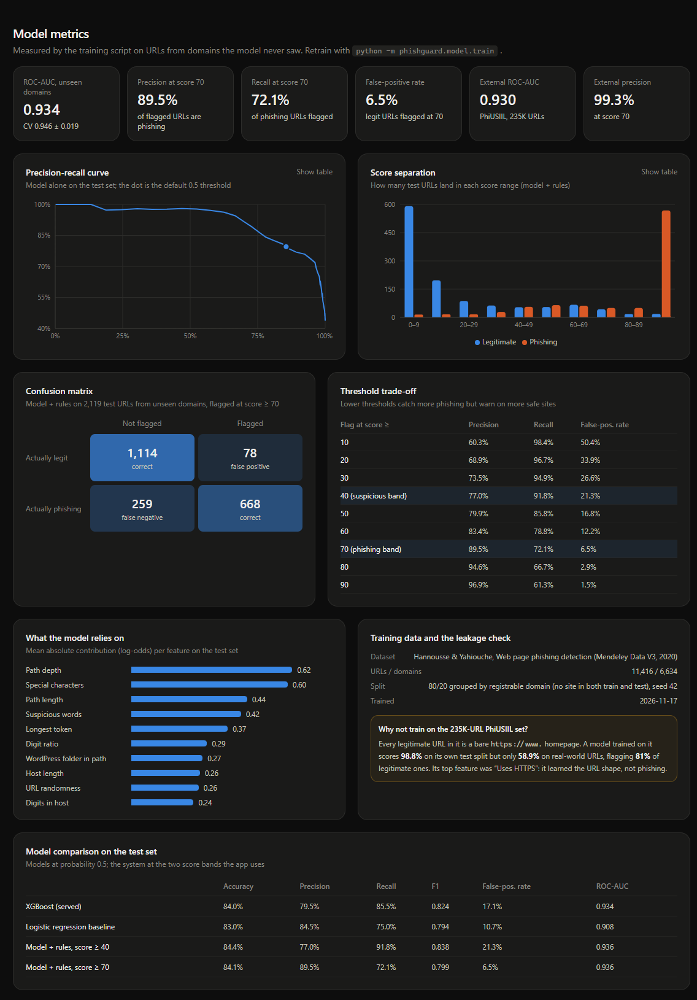
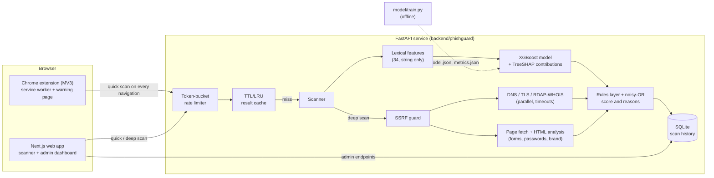

# PhishGuard

Phishing and malicious URL detection with explainable scores. You get a FastAPI service (machine-learning model plus a rules layer), a Next.js web app with a scanner and an admin dashboard, and a Chrome extension that shows a warning page before a risky page loads.



**What a scan returns:** a 0–100 risk score, a verdict (safe / suspicious / likely phishing), plain-language reasons, and each feature's contribution to the model's decision.

| | |
|---|---|
|  |  |
| The extension replaces a phishing page **before it loads** (measured: 0.2–0.3 s after navigation starts) | A deep scan adds domain age (RDAP/WHOIS), the TLS certificate, DNS records and the fetched page |
|  |  |
| Live scan history, verdict mix, latency and top flagged domains | Model metrics measured on domains the model never saw |

## Quick start (Windows)

You need Python 3.11+ (the `py` launcher) and Node.js 20+. Everything else is installed for you.

```bash
start.bat
```

The first run creates `.venv`, installs packages and builds the web app (a few minutes); later runs take seconds. It opens:

- Scanner: http://localhost:3100
- Dashboard: http://localhost:3100/admin
- API docs (Swagger): http://127.0.0.1:8000/docs

Stop everything with `.\stop.ps1`. Options: `.\start.ps1 -Dev` (hot reload), `.\start.ps1 -Retrain` (download data and retrain first).

**Chrome extension:** open `chrome://extensions`, turn on *Developer mode*, click **Load unpacked** and pick the `extension` folder. Then open any page; the toolbar badge shows its score.

**Sample data for the dashboard** (while the API runs):

```bash
.venv\Scripts\python.exe backend\scripts\demo_scans.py
```

### Retraining the model (what to run)

A trained model is committed in `backend/models/`, so you only need this to reproduce the numbers:

```bash
cd backend
..\.venv\Scripts\python.exe scripts\download_datasets.py
..\.venv\Scripts\python.exe -m phishguard.model.train
```

The download script fetches two public CC BY 4.0 datasets (about 19 MB) into `backend/data/raw/` and checks pinned SHA-256 hashes. Training takes about a minute and rewrites `models/model.json` and `models/metrics.json`. Training is deterministic, so you get the same model.

## Architecture



**Quick scan** (milliseconds, no network): the URL is normalised and turned into 34 lexical features. The model scores them, and the lexical rules (lookalike domains, brand in subdomain, raw IP, `@` trick, abused TLD, ...) add their evidence. The browser extension uses this before a page loads.

**Deep scan** (about 0.6 s cold): adds DNS records, the TLS certificate, the domain's registration date (RDAP first, port-43 WHOIS as fallback) and the page itself (password fields, forms that post to another site, a title that claims a brand the domain does not own). These run in parallel, each with a hard timeout. Every outbound connection goes through an SSRF guard. Redirects are followed by hand so that a shortened link is scored at its destination.

**Scoring:** `risk = 1 − (1 − p_model) × Π(1 − w_rule)` (noisy-OR). One strong signal is enough, more evidence only adds, and the score never passes 100. Well-known domains are capped at 10, except platforms where anyone can publish (sites.google.com, *.github.io, ...). Bands: < 40 safe, 40–69 suspicious, ≥ 70 likely phishing.

## Results (measured)

All model numbers come from `python -m phishguard.model.train` and are saved in `backend/models/metrics.json`. The test set is **2,119 URLs from 1,327 domains the model never saw**: the 80/20 split is grouped by registrable domain, so no site appears in both train and test.

| Model / system | Accuracy | Precision | Recall | False-pos. rate | ROC-AUC |
|---|---|---|---|---|---|
| XGBoost (served), p ≥ 0.5 | 84.0% | 79.5% | 85.5% | 17.1% | **0.934** |
| Logistic-regression baseline | 83.0% | 84.5% | 75.0% | 10.7% | 0.908 |
| Model + rules, score ≥ 40 (suspicious) | 84.4% | 77.0% | 91.8% | 21.3% | 0.936 |
| Model + rules, score ≥ 70 (extension warns) | 84.1% | **89.5%** | 72.1% | **6.5%** | 0.936 |

- **5-fold grouped cross-validation** (training part only): F1 0.870 ± 0.022, ROC-AUC 0.946 ± 0.019.
- **External test** on PhiUSIIL (234,685 URLs, other researchers, collected years later): ROC-AUC **0.930**. At score ≥ 70: **99.3% precision** and a **0.33% false-positive rate** on 135K legitimate URLs. Recall is 58.5%: the URL alone cannot reveal phishing on a bare, innocent-looking domain, which is what deep scans are for.
- **Leakage check:** the same model trained on PhiUSIIL scores 98.8% on its own test split but only **58.9%** on realistic URLs, flagging 81% of legitimate ones, because every legitimate URL in PhiUSIIL is a bare `https://www.` homepage. Its top feature was "uses HTTPS". This is why PhishGuard trains on the smaller, realistic dataset.
- **Random vs grouped split:** a random split would report 88.1% accuracy (ROC-AUC 0.955) instead of 84.1%, because URLs from the same site land on both sides.

**Latency** (`python -m phishguard.benchmark --full`, median of 3 runs of 500 requests, laptop):

| Path | p50 | p95 |
|---|---|---|
| Quick scan, in process | 1.5 ms | 1.7 ms (~640 URLs/s on one thread) |
| Quick scan over HTTP | 3.6 ms | 4.2 ms |
| Cache hit over HTTP | 1.2 ms | 2.2 ms |
| Deep scan over HTTP, cold caches (real sites) | 623 ms | 669 ms |

Profiling showed that writing to the history table took 7.3 ms per scan, because the code opened a new SQLite connection per call. Sharing one locked connection cut quick-scan p50 over HTTP **from 12.8 ms to 3.6 ms**.

**Tests:** 114 automated tests (104 backend with pytest, 6 extension with `node --test`, 4 frontend), all offline. I also tested the extension end to end in headless Edge over the DevTools protocol: the warning appears, "Continue anyway" and "Always trust" work, and safe sites are not interrupted.

## Project layout

```
backend/
  phishguard/
    features/      parsing.py (normalise URL), lexical.py (34 features), lookalike.py
                   (homoglyphs, typosquats), brands.py (reference lists), netguard.py
                   (SSRF guard), host.py (DNS/TLS/RDAP-WHOIS), page.py (HTML analysis)
    model/         dataset.py, train.py, predictor.py (XGBoost + TreeSHAP), explain.py
    rules.py       hand-written checks -> weighted reasons
    scoring.py     noisy-OR combination, known-good cap, verdict bands
    scanner.py     the pipeline: features -> model -> rules -> result
    api.py         FastAPI app (cache, rate limit, admin endpoints); main.py starts it
    cache.py, ratelimit.py, store.py (SQLite), config.py, benchmark.py
  scripts/         download_datasets.py, demo_scans.py
  models/          model.json (XGBoost, JSON not pickle), metrics.json
  tests/           104 pytest tests, no network
extension/         manifest.json, background.js (service worker), warning/popup/options
                   pages, lib/core.js (pure, unit-tested), tests/
frontend/          Next.js 16 + TypeScript + Tailwind v4: app/ (pages), components/, lib/
docs/              STUDY_GUIDE.md, RESUME_BULLETS.md, benchmark.json, screenshots/
start.ps1 / start.bat / stop.ps1
```

## API

| Method | Path | Purpose |
|---|---|---|
| POST | `/api/scan` | `{"url": "...", "mode": "fast" \| "full"}` → score, verdict, reasons, contributions, features |
| GET | `/api/health` | liveness and model training date |
| GET | `/api/admin/stats` | totals, verdict mix, latency percentiles, scans per day, cache stats |
| GET | `/api/admin/history` | recent scans (`?limit=&verdict=&q=`) |
| GET | `/api/admin/scans/{id}` | one stored scan in full |
| GET | `/api/admin/top-domains` | most-flagged registrable domains |
| GET | `/api/admin/metrics` | the training metrics |

Rate limit: a token bucket per client IP (30 burst, 30/minute sustained). A deep scan costs 5 tokens because it makes outbound requests. Excess requests get `429` with `Retry-After`. Admin endpoints require the `X-Admin-Token` header when `PHISHGUARD_ADMIN_TOKEN` is set. Other settings use `PHISHGUARD_*` environment variables (see `backend/phishguard/config.py`).

## Running the tests

```bash
cd backend
..\.venv\Scripts\python.exe -m pytest
```

```bash
cd extension
npm test
```

```bash
cd frontend
npm test
```

```bash
cd frontend
npm run typecheck
```

## Security and privacy notes

- **SSRF guard:** a deep scan never connects to private, loopback, link-local (cloud metadata) or carrier-NAT addresses. Each redirect hop is re-checked, and the TLS check connects to the exact IP it validated.
- **No pickle:** the model is stored as XGBoost JSON. The datasets' `.pickle` files are never downloaded, because unpickling untrusted data runs code. Downloads are verified against pinned SHA-256 hashes, and zip extraction takes one named member (no zip slip).
- **No XSS from scanned content:** hostnames and page titles are attacker-controlled. React escapes them, and the extension only uses `textContent` for them.
- **Static HTML only:** fetched pages are parsed, never executed. Requests are capped at 1 MB, 5 redirects and ~6 s.
- **Privacy:** the extension sends every visited URL to *your local* API and nowhere else. A hosted version should use hashed URL prefixes, as Safe Browsing does (see the study guide).

## Known limitations

- The model sees only the URL text. Phishing on a hacked but innocent-looking domain is hard to catch without a deep scan, and kits that build their login form with JavaScript are missed because pages are not executed.
- The training data is from 2020. Attack styles drift, so a production system would retrain regularly on fresh feeds (PhishTank, OpenPhish).
- Some honest sites score high: unfamiliar subdomains (`news.ycombinator.com` scores 47), Google Forms links and bare shortened links in quick mode. The allowlist and deep scans address most of these.
- The browser extension wins the race against page load almost always, but on a very slow API the page may flash before the warning (MV3 no longer lets extensions block requests synchronously).

## Resume bullets

- Built a phishing-URL detection system combining an XGBoost model on 34 URL features with DNS, TLS, RDAP/WHOIS and page-form checks; reached **0.934 ROC-AUC on URLs from 1,327 unseen domains** and **99.3% precision (0.33% false-positive rate) on an external 235K-URL dataset**, with per-feature SHAP explanations for every score.
- Found and fixed training-data leakage: showed that a model trained on a popular public dataset scored **98.8% in-distribution but 58.9% on realistic URLs**, then trained with a domain-grouped split and removed a hidden "www" proxy feature, raising external precision from **96.2% to 98.0%**.
- Engineered a FastAPI service and Chrome MV3 extension that warn **before a phishing page loads (0.2–0.3 s)**: **3.6 ms p50** quick scans over HTTP (cut from 12.8 ms by profiling a SQLite bottleneck), TTL/LRU caching, token-bucket rate limiting, an SSRF guard on every redirect hop, and **114 automated tests**.

Shorter variants and what to say about each number: [docs/RESUME_BULLETS.md](docs/RESUME_BULLETS.md). Interview preparation: [docs/STUDY_GUIDE.md](docs/STUDY_GUIDE.md).

## Data credits

- Hannousse, A. & Yahiouche, S. (2021). *Web page phishing detection*, Mendeley Data V3, doi:10.17632/c2gw7fy2j4.3. CC BY 4.0. Used for training and testing.
- Prasad, A. & Chandra, S. (2024). *PhiUSIIL Phishing URL Dataset*, UCI Machine Learning Repository. CC BY 4.0. Used for external testing and the leakage check.
